# 01 — Serveur de gestion de parc GLPI

**Contexte :** travaux pratiques BTS SIO (novembre 2026)
**Environnement :** VMware Workstation · Debian 13 (sans interface graphique) · Apache · PHP 8.4 · MariaDB · GLPI 11

## Objectif

Déployer un serveur de gestion de parc et de helpdesk (GLPI) sécurisé, puis y modéliser le parc informatique d'une PME fictive.

## Architecture

```
[ Poste Windows 11 ]  --(GLPI Agent : inventaire)-->  [ VM Debian 13 ]
                                                       ├── Apache (VirtualHost → /var/www/glpi/public)
                                                       ├── PHP 8.4
                                                       └── MariaDB (base glpi, utilisateur dédié)
```

## Étapes réalisées

### 1. Préparation du serveur Debian

- Installation de Debian 13 **sans interface graphique**.
- Configuration d'une **adresse IP fixe** dans `/etc/network/interfaces`.
- Définition du **nom d'hôte** et du **FQDN** dans `/etc/hosts`.

```bash
# Exemple de configuration (adresses génériques)
auto ens33
iface ens33 inet static
    address 192.168.X.10/24
    gateway 192.168.X.1
```

### 2. Installation de la pile web

```bash
sudo apt update
sudo apt install apache2 mariadb-server php libapache2-mod-php \
     php-mysql php-xml php-curl php-gd php-intl php-mbstring php-zip php-bz2 php-ldap
```

### 3. Base de données MariaDB

Création d'une base dédiée et d'un **utilisateur aux droits limités** à cette seule base (principe du moindre privilège).

```sql
CREATE DATABASE glpi;
CREATE USER 'glpi_user'@'localhost' IDENTIFIED BY '********';
GRANT ALL PRIVILEGES ON glpi.* TO 'glpi_user'@'localhost';
FLUSH PRIVILEGES;
```

### 4. Déploiement de GLPI 11

- Téléchargement de l'archive officielle de GLPI 11 et extraction dans `/var/www/glpi`.
- Attribution des droits au compte du serveur web (`www-data`).
- **VirtualHost Apache** pointant uniquement sur le dossier `public/` de GLPI, pour ne pas exposer le reste de l'application.

```apache
<VirtualHost *:80>
    ServerName glpi.lan
    DocumentRoot /var/www/glpi/public

    <Directory /var/www/glpi/public>
        Require all granted
        RewriteEngine On
        RewriteCond %{REQUEST_FILENAME} !-f
        RewriteRule ^(.*)$ index.php [QSA,L]
    </Directory>
</VirtualHost>
```

```bash
sudo a2enmod rewrite
sudo a2ensite glpi.conf
sudo systemctl reload apache2
```

### 5. Sécurisation après installation

| Mesure | Pourquoi |
|---|---|
| Utilisateur MariaDB dédié aux droits limités | Une compromission de GLPI ne donne pas accès aux autres bases |
| VirtualHost sur `public/` uniquement | Les fichiers de configuration et le code ne sont pas accessibles depuis le web |
| Suppression du script d'installation (`install/install.php`) | Empêche une réinstallation qui écraserait la configuration |
| Comptes par défaut (`glpi`, `tech`, `normal`, `post-only`) désactivés ou mot de passe changé | Ces identifiants sont publics et connus de tous |

### 6. Modélisation du parc d'une PME

- Création des **lieux**, **services**, **statuts** et **techniciens**.
- Import de **16 utilisateurs** et **20 postes** par fichier CSV avec le plugin **Data Injection**.
- Suivi des **garanties**, d'un **contrat de location** et du **cycle de vie** des postes.

### 7. Inventaire automatique

- Installation de **GLPI Agent** sur un poste **Windows 11**.
- Remontée automatique du matériel et des logiciels du poste dans GLPI.

## Difficultés rencontrées et solutions

| Problème | Solution |
|---|---|
| Debian installé avec l'environnement GNOME par erreur | Réinstallation propre sans interface graphique |
| `sudo` absent (mot de passe root défini à l'installation) | Installation de `sudo` via `su -` et ajout de l'utilisateur au groupe `sudo` |
| Configuration réseau écrite pour une interface inexistante (`ens33` au lieu de `ens37`) | Repérage avec `ip -br a`, correction de `/etc/network/interfaces` |
| VM en NAT VMware et non sur le réseau du labo | Plan d'adressage adapté au réseau NAT |
| Base `glpidb` invisible pour l'utilisateur dédié | `SHOW GRANTS` : le `GRANT` manquait, relancé |
| Lieux saisis sans accent (`1er etage`) alors que le CSV contient `1er étage` | Renommage avant l'import pour éviter les doublons |
| Version du plugin Data Injection prévue pour GLPI 10 | Installation de la branche 2.15.x compatible GLPI 11 |

## Captures d'écran

### Partie A — Installation du serveur

| | |
|---|---|
| 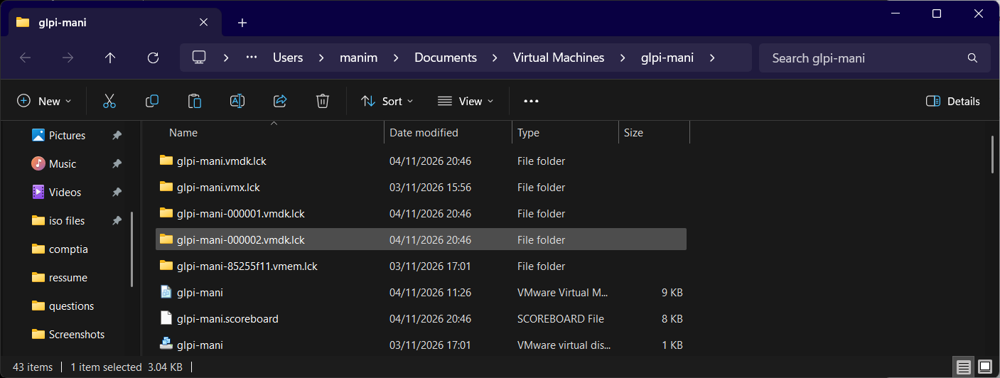 | 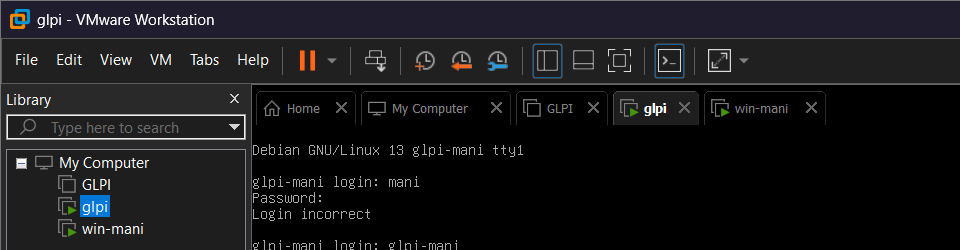 |
| Fichiers de la VM (nom donné à la création) | Nom affiché dans VMware |

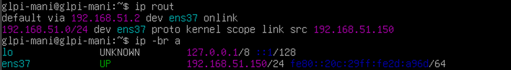
*Adresse IP fixe et passerelle (`ip route`, `ip -br a`)*

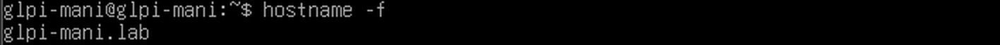
*Nom d'hôte complet (`hostname -f`)*

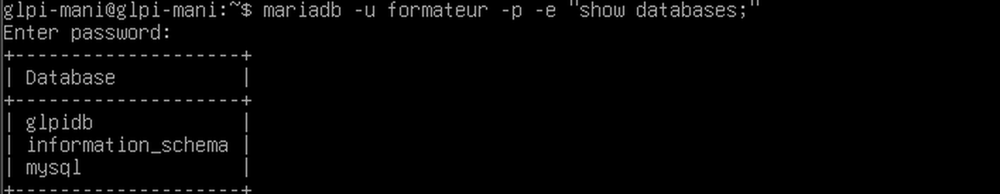
*L'utilisateur dédié voit la base de GLPI*

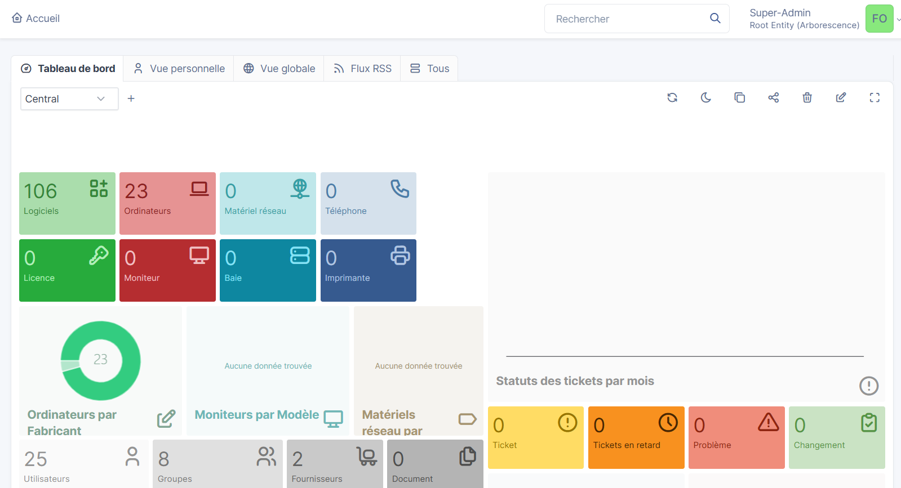
*GLPI installé et sécurisé : aucun avertissement, parc de 23 ordinateurs*

### Partie B — Construction du parc

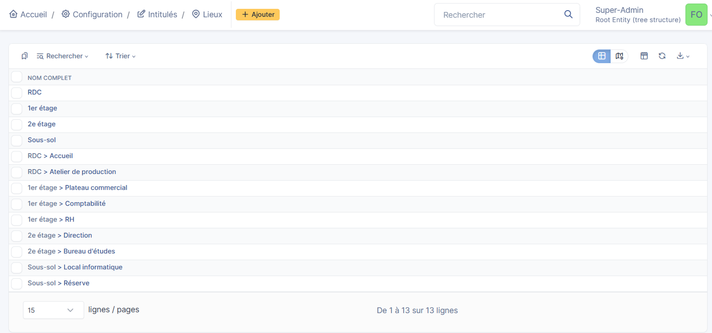
*Arborescence des lieux (étage › pièce)*

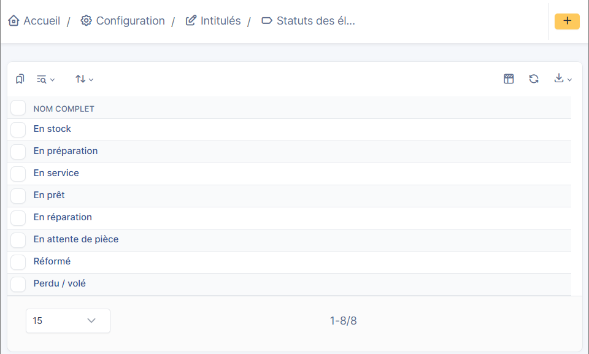
*Statuts du cycle de vie*

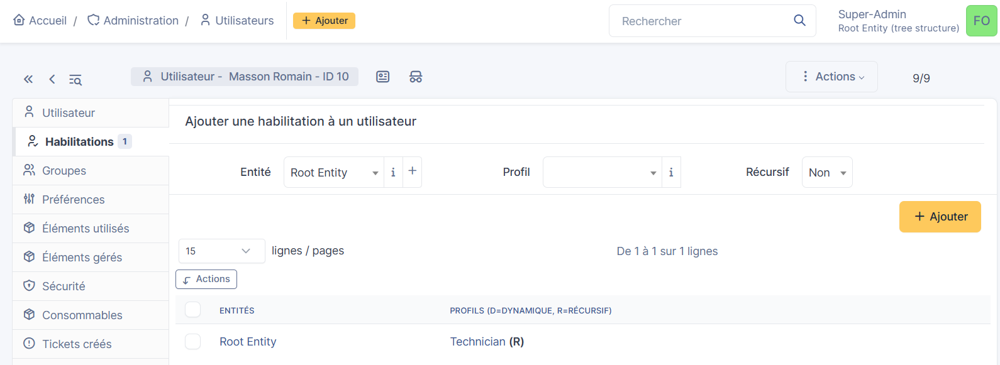
*Technicien : profil Technician sur l'entité racine*

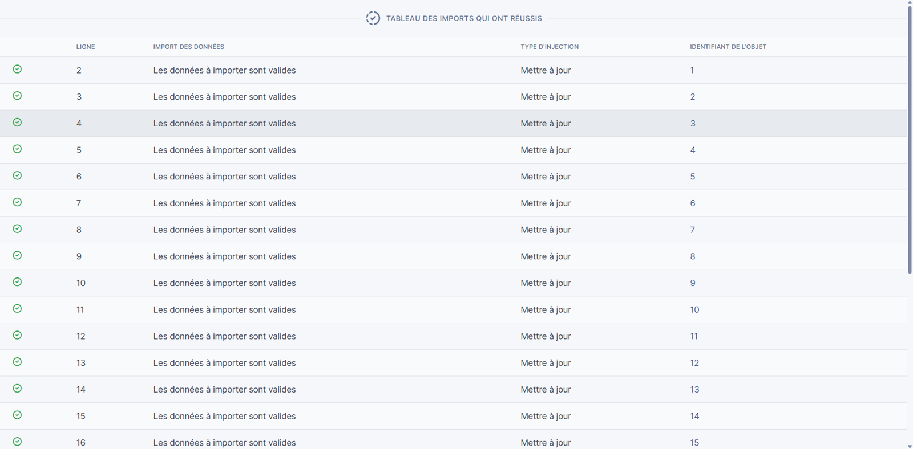
*Second import du même CSV : « Mettre à jour » partout, aucun doublon grâce au numéro de série*

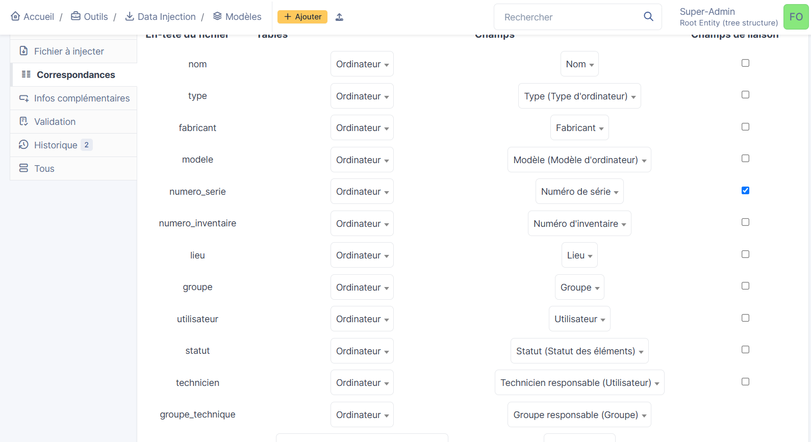
*Correspondances colonnes CSV → champs GLPI (Data Injection)*

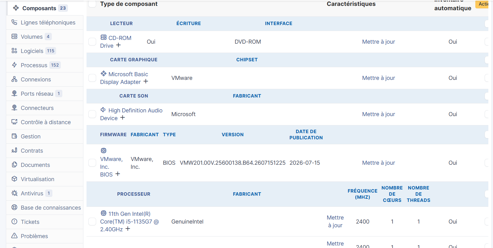
*Poste Windows 11 inventorié automatiquement par GLPI Agent : composants*

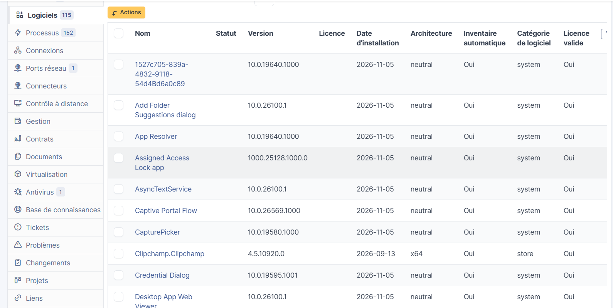
*… et logiciels installés*

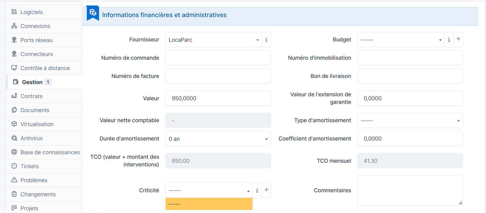
*Informations financières d'un portable (fournisseur, valeur, TCO)*

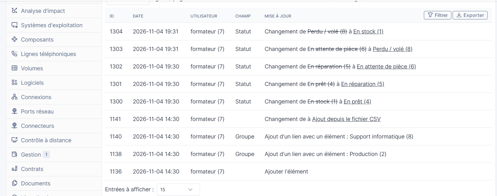
*Historique : traçabilité de chaque changement de statut*

## Livrables

- [Compte rendu complet (PDF)](livrables/compte-rendu-atelier-glpi.pdf)
- [utilisateurs.csv](livrables/utilisateurs.csv) — 16 utilisateurs fictifs
- [parc_ateliers_mercier.csv](livrables/parc_ateliers_mercier.csv) — 20 postes fictifs

## Ce que j'ai appris

- Déployer une application web complète (serveur web + PHP + base de données) sur un serveur Linux sans interface graphique.
- Appliquer des réflexes de sécurité dès l'installation : moindre privilège, réduction de la surface exposée, suppression des comptes par défaut.
- Utiliser un outil de gestion de parc comme en entreprise : import en masse, inventaire automatique, suivi du cycle de vie.
