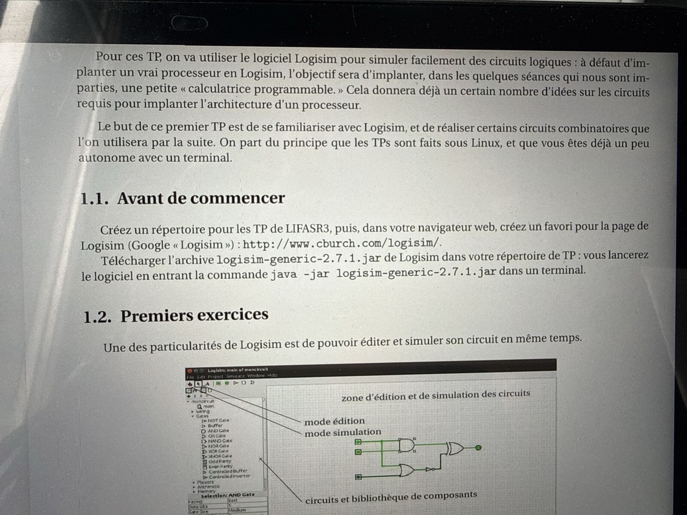
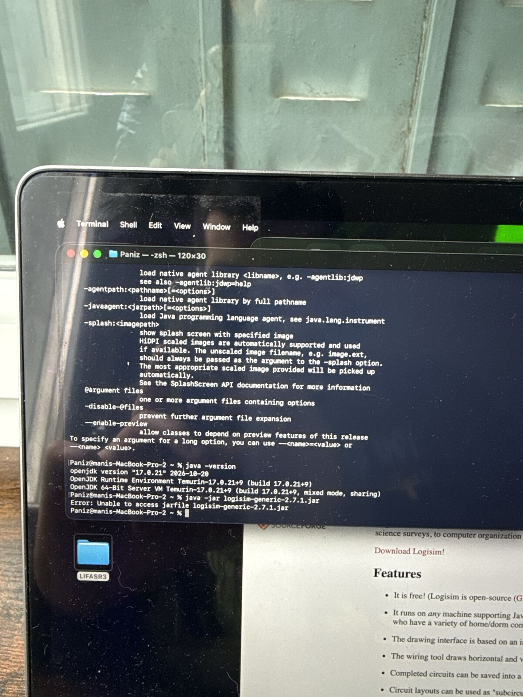
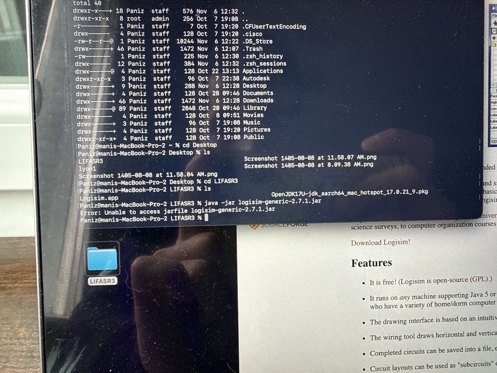
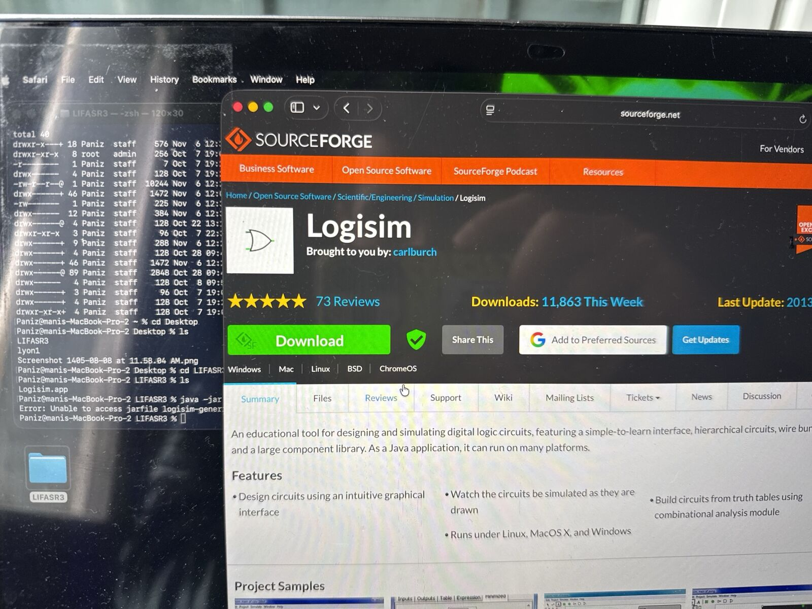

# 05 — Installation de Logisim sur macOS (TP circuits logiques)

**Contexte :** travaux pratiques BTS (LIFASR3 — architecture des ordinateurs, circuits logiques)
**Environnement :** MacBook Pro (Apple Silicon) · macOS · Java (OpenJDK 17 Temurin) · Logisim 2.7.1

## Objectif

Préparer le poste pour les TP de circuits logiques : installer **Java**, télécharger **Logisim** et le lancer depuis le terminal. Le sujet du TP part du principe que l'on travaille sous Linux ; il a fallu adapter les étapes à macOS.



Le but du TP : se familiariser avec Logisim, puis réaliser des **circuits combinatoires** qui serviront à construire une petite **« calculatrice programmable »**. C'est une première approche des circuits nécessaires à l'architecture d'un processeur.

## Étapes réalisées

1. Création d'un répertoire de travail `LIFASR3` sur le Bureau.
2. Installation de **Java** (OpenJDK 17, build Temurin, paquet `.pkg` pour `aarch64`), puis vérification :

```bash
java -version
# openjdk version "17.0.21" ... Temurin-17.0.21+9
```

3. Téléchargement de Logisim et lancement avec la commande du sujet :

```bash
cd ~/Desktop/LIFASR3
java -jar logisim-generic-2.7.1.jar
```

## Difficultés rencontrées

| Problème | Cause | Solution |
|---|---|---|
| `Error: Unable to access jarfile logisim-generic-2.7.1.jar` (lancé depuis `~`) | Le terminal n'était pas dans le dossier contenant le fichier | Se placer dans le bon dossier avec `cd ~/Desktop/LIFASR3` et vérifier avec `ls` |
| Même erreur depuis le dossier `LIFASR3` | Le bouton **Download** de SourceForge fournit la version Mac (`Logisim.app`), pas le fichier `.jar` attendu. La version Mac est ancienne et peu compatible avec macOS récent | Télécharger la version **generic** : SourceForge → onglet **Files** → `2.7.x` → `2.7.1` → `logisim-generic-2.7.1.jar` |







Commandes finales :

```bash
cd ~/Desktop/LIFASR3
mv ~/Downloads/logisim-generic-2.7.1.jar .
java -jar logisim-generic-2.7.1.jar
```

## Ce que j'ai appris

- Lire un message d'erreur : `Unable to access jarfile` signifie que le **chemin** est faux ou que le fichier n'existe pas, pas que Java est mal installé.
- Toujours vérifier le **répertoire courant** et son contenu (`pwd`, `ls`) avant de lancer un fichier.
- Un fichier `.jar` « generic » fonctionne sur toutes les plateformes qui ont Java. C'est souvent plus fiable qu'une version empaquetée ancienne pour un OS précis.
- Adapter les consignes d'un TP prévu pour Linux à macOS : les commandes du terminal sont presque identiques.

## Sources

- [Logisim — site officiel](http://www.cburch.com/logisim/)
- [Logisim — fichiers sur SourceForge](https://sourceforge.net/projects/circuit/files/2.7.x/2.7.1/)
- [Adoptium (Temurin) — installation](https://adoptium.net/installation/)
